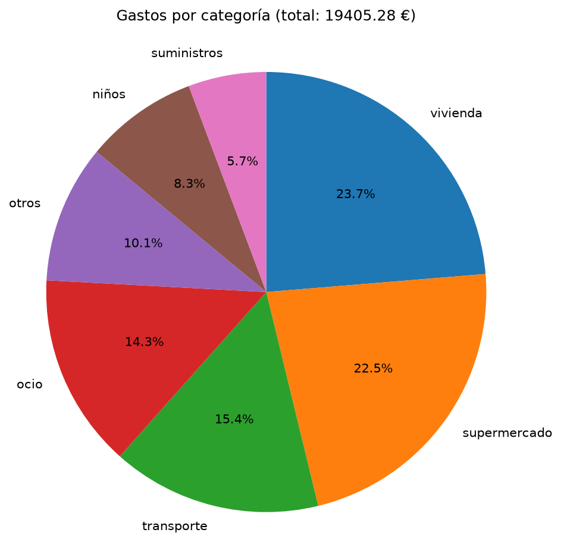
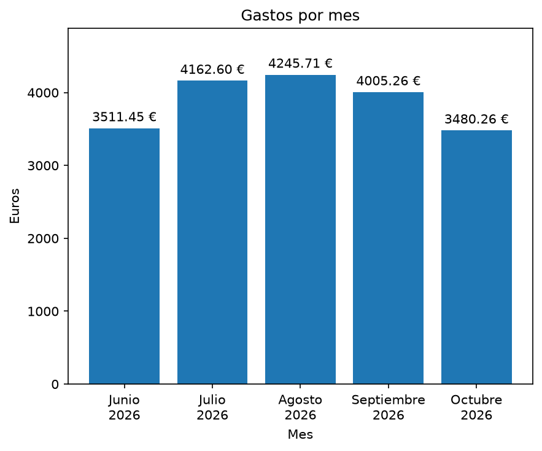

# 💰 Gestor de Gastos Personales

Programa en Python para apuntar mis gastos del día a día y ver en qué gasto más dinero.

## Funcionalidades

- Añadir gastos con descripción, cantidad, categoría y fecha (Enter = hoy)
- Lee también los CSV guardados con Excel en español (separados por `;`)
- Ver la lista de todos los gastos
- Ver el total gastado por categoría
- Ver los gastos agrupados por mes, con el total de cada mes
- Gráfico de tarta por categorías (las de menos del 5 % se agrupan en "otros")
- Gráfico de barras por mes, con la cantidad en euros encima de cada barra
- Guardar los gráficos como PNG además de mostrarlos
- Editar y borrar gastos
- Los gastos se guardan en un archivo CSV para no perderlos al cerrar

## Cómo usarlo

1. Tener Python 3 instalado
2. Descargar el proyecto
3. (Opcional, para los gráficos) Instalar matplotlib:
```
pip install -r requirements.txt
```
4. Ejecutar:
```
python main.py
```

## Capturas

Hechas con datos de ejemplo.

| Gastos por categoría | Gastos por mes |
|---|---|
|  |  |

## Pruebas de los gráficos

| Caso | Resultado |
|---|---|
| Sin gastos | Aviso "No hay gastos todavía." en vez de un gráfico vacío |
| Un solo gasto | Tarta de una porción (100 %) y una sola barra |
| Gastos "sin fecha" | Fuera del gráfico de barras, con aviso de cuántos se han quedado fuera (si todos son "sin fecha", no se dibuja) |
| Muchas categorías (30) | Las de menos del 5 % se agrupan en "otros" |
| Sin matplotlib instalado | Mensaje explicando cómo instalarlo; el resto del programa funciona |

## Tecnologías

- Python 3
- Módulo `csv`
- `matplotlib` (opcional, solo para los gráficos)

## Hoja de ruta

- [x] V1: añadir gastos, ver la lista y el total por categoría, guardar en CSV
- [x] V2: fechas, gastos por mes, editar y borrar, CSV a prueba de errores
- [x] V3: gráficos de tarta por categorías y de barras por mes (con matplotlib)
- [ ] Interfaz web con Streamlit
- [ ] Categorización automática con IA

## Autor

Pablo — Estudiante de 2º de Ingeniería en Computación e IA en la UAX Mare Nostrum